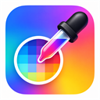

# Pixel Color Picker

Pick the exact visible HEX color from any normal website, image, gradient, illustration, canvas, SVG or video frame directly in your browser.

## Features

- Browser-wide activation across eligible tabs.
- Automatic activation after opening a tab or navigating to another website.
- Pixel sampling from the rendered browser viewport.
- Floating HEX value and live color swatch.
- Short right-click copies the displayed HEX value.
- Holding the right mouse button for about 800 ms closes the picker.
- Escape closes the picker across all tabs.
- No backend, analytics, API key or external image service.

## Install in Chrome or Brave

1. Download `Pixel-Color-Picker-v1.1.5-final.zip` from the GitHub Releases page.
2. Extract the ZIP to a folder. Do not select the ZIP itself.
3. Open `chrome://extensions` in Chrome or `brave://extensions` in Brave.
4. Enable **Developer mode**.
5. Choose **Load unpacked**.
6. Select the extracted folder containing `manifest.json`.
7. Open the extension details and set **Site access** to **On all sites** if the browser asks for approval.
8. Refresh any webpages that were already open.

## Use the picker

Click the toolbar icon once to activate it across all eligible tabs. Move the pointer over the pixel you want to inspect. The preview follows the pointer and shows the current HEX value.

- Short right-click: copy the displayed HEX value and keep the picker active.
- Right-button hold for about 800 ms: deactivate the picker globally.
- Escape: deactivate the picker globally.
- Toolbar icon: toggle the picker globally.

Normal left-clicks are allowed to pass through to the website, so links, images and page controls remain usable while the picker is active.

## Browser restrictions

Normal HTTP and HTTPS websites require the browser's **On all sites** permission. Browser-internal pages such as `chrome://`, `brave://`, extension pages and the Chrome Web Store do not allow content-script injection and are skipped gracefully. Cross-origin content inside an iframe may not receive pointer tracking. Animated content can change after the most recent screenshot capture.

## Screenshots

Screenshots will be added here in a future documentation update.

## Project purpose and technology

Pixel Color Picker is a lightweight Manifest V3 browser extension for designers, developers and anyone who needs the color of a visible browser pixel. It uses vanilla JavaScript, a background service worker, `captureVisibleTab`, canvas pixel processing and an isolated floating preview.

## Version 1.1.6

This release hardens deactivation cleanup so long right-click, Escape and toolbar deactivation remove the preview immediately and cannot be undone by pending animation frames or screenshot captures. It preserves the approved project branding, persistent browser-wide activation state, all-sites website access configuration, automatic tab and navigation synchronization, and clean installable release packaging.

## License

No license file has been added yet. All rights remain with the project owner until a license is provided.
